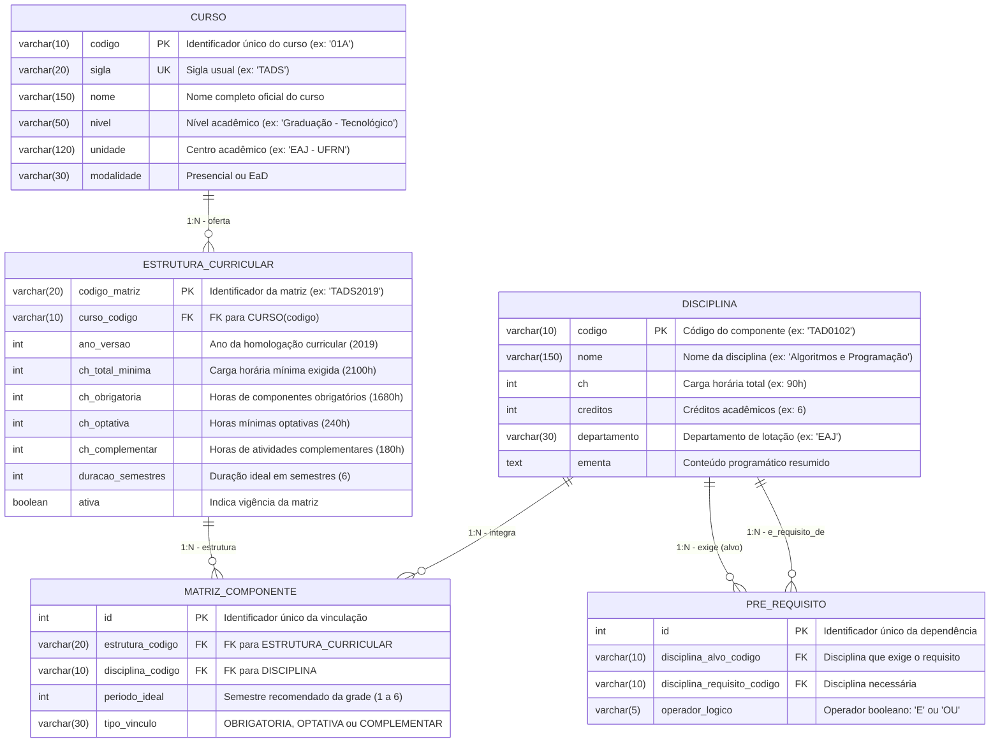

# Modelo Lógico 1: Abordagem Relacional (SQL / 3FN)

> **Pasta do Modelo:** `modelagem/1_relacional/`  
> **Arquivo do Diagrama:** [diagrama_relacional.mmd](diagrama_relacional.mmd)  
> **Visualizador Web Interativo:** [visualizar_diagrama.html](visualizar_diagrama.html)  
> **Consultas de Exemplo:** [consultas_exemplos.sql](consultas_exemplos.sql)  
> **SGBD Físico Alvo:** PostgreSQL 16  

---

## 1. Fundamentação Teórica e Justificativa da Modelagem

O paradigma relacional fundamenta-se na **Álgebra Relacional** e na teoria dos conjuntos formulada por Edgar F. Codd. Para representar a estrutura curricular do TADS 2019 de forma estritamente normalizada na **3ª Forma Normal (3FN)**, as seguintes premissas de negócio foram aplicadas:

1. **Desacoplamento entre Curso e Disciplina:**  
   Uma disciplina como `TAD0102 - Algoritmos e Programação` possui atributos intrínsecos (nome, carga horária, créditos, departamento, ementa) que não dependem do curso onde ela é ministrada. Se o TADS ou o BTI utilizarem a mesma matéria, seus dados cadastrais não devem ser duplicados.
2. **Entidade Associativa `MATRIZ_COMPONENTE`:**  
   A vinculação de uma disciplina a um curso específico com seu respectivo semestre ideal (1º ao 6º período) e natureza (*OBRIGATÓRIA* ou *OPTATIVA*) é um atributo da relação entre a Matriz Curricular e a Disciplina. Por isso, foi modelada a tabela associativa `MATRIZ_COMPONENTE` com chave estrangeira composta e restrição de unicidade.
3. **Dependências em Auto-Relacionamento com Semântica Booleana:**  
   A relação de pré-requisito é modelada como um auto-relacionamento na tabela `PRE_REQUISITO`. Cada tupla conecta uma `disciplina_alvo_codigo` à sua `disciplina_requisito_codigo`. Além disso, a coluna `operador_logico` armazena os valores `'E'` (conjunção mandatória) e `'OU'` (disjunção alternativa), refletindo com exatidão as regras do fluxograma oficial do SIGAA.

---

## 2. Diagrama Entidade-Relacionamento



---

## 3. Estratégia de Implementação Física e Índices (PostgreSQL 16)

```sql
-- Índices essenciais para que as consultas de grade e recursão sejam eficientes
CREATE INDEX idx_matriz_estrutura_periodo ON matriz_componente(estrutura_codigo, periodo_ideal);
CREATE INDEX idx_disciplina_nome ON disciplina(nome);
CREATE INDEX idx_pre_requisito_alvo ON pre_requisito(disciplina_alvo_codigo);
CREATE INDEX idx_pre_requisito_origem ON pre_requisito(disciplina_requisito_codigo);
```

---

## 4. Como o Modelo Resolve as Perguntas de Negócio

1. **"Quais são as matérias do 3º período de TADS 2019?"**  
   Resolvido por uma junção direta `matriz_componente` $\bowtie$ `disciplina` filtrando `periodo_ideal = 3`.
2. **"Quais são todos os pré-requisitos necessários para cursar Projetos Aplicados II?"**  
   Resolvido por meio de uma **Common Table Expression Recursiva (`WITH RECURSIVE`)** que navega em profundidade na tabela `pre_requisito`.
3. **"Se o aluno for reprovado em TAD0102, quais matérias ficam trancadas?"**  
   Resolvido pelo CTE recursivo no sentido inverso (a jusante).

