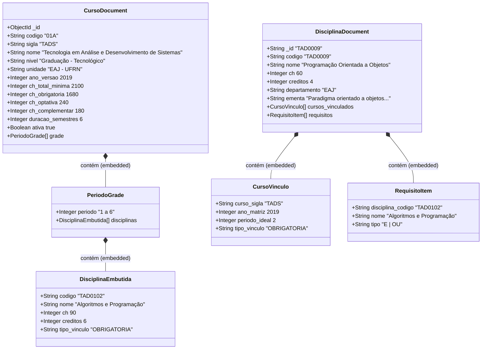

# Modelo Lógico 2: Abordagem Não Relacional em Documentos (MongoDB)

> **Pasta do Modelo:** `modelagem/2_documentos/`  
> **Arquivo do Diagrama:** [diagrama_documentos.mmd](diagrama_documentos.mmd)  
> **Visualizador Web Interativo:** [visualizar_diagrama.html](visualizar_diagrama.html)  
> **Esquema de Validação JSON:** [schema_colecoes.json](schema_colecoes.json)  
> **Consultas de Exemplo:** [consultas_exemplos.js](consultas_exemplos.js)  
> **SGBD Físico Alvo:** MongoDB 7.0 Community Edition  

---

## 1. Fundamentação Teórica e Justificativa da Modelagem

O paradigma orientado a documentos armazena dados em formatos semiestruturados hierárquicos (BSON/JSON). A modelagem de dados para o problema da grade curricular foi desenhada com base nos princípios modernos de **Engenharia de Dados em NoSQL**:

1. **Otimização Extrema para Leitura (*Read-Optimized Pattern*):**  
   Em um sistema acadêmico, a consulta à matriz curricular completa de um curso é uma operação de altíssima frequência e baixa taxa de mutação (uma matriz após homologada raramente muda). No modelo relacional tradicional, renderizar a grade do TADS exige junções entre 4 tabelas (`curso`, `estrutura`, `matriz_componente` e `disciplina`). No MongoDB, criamos a coleção `cursos` contendo a grade embutida por semestres: uma única leitura `findOne()` por `_id` retorna o curso completo em menos de 1 milissegundo.
2. **Separação Estratégica do Catálogo (`disciplinas`):**  
   Para permitir que uma disciplina seja pesquisada isoladamente por código, ementa ou departamento, mantemos a coleção `disciplinas`. Nela, os pré-requisitos são modelados como um *array* embutido de subdocumentos:
   ```json
   "requisitos": [
     { "disciplina_codigo": "TAD0102", "nome": "Algoritmos e Programação", "tipo": "E" },
     { "disciplina_codigo": "TAD0012", "nome": "Processo de Desenv. de Software", "tipo": "E" }
   ]
   ```
3. **Resolução de Árvores de Dependência via `$graphLookup`:**  
   Para responder à pergunta *"quais são todos os pré-requisitos transitivos de uma disciplina?"*, o MongoDB dispõe do operador nativo `$graphLookup` no Aggregation Pipeline, realizando travessia recursiva entre documentos da coleção com controle de profundidade máxima (`maxDepth`).

---

## 2. Diagrama de Classes e Estrutura dos Documentos



---

## 3. Índices Estratégicos no MongoDB

```javascript
// Índice único do código da disciplina
db.disciplinas.createIndex({ "codigo": 1 }, { unique: true });

// Índice textual para busca rápida por palavras-chave na ementa
db.disciplinas.createIndex({ "nome": "text", "ementa": "text" });

// Índice multikey para buscas reversas em pré-requisitos
db.disciplinas.createIndex({ "requisitos.disciplina_codigo": 1 });

// Índice composto para filtros por curso e semestre
db.disciplinas.createIndex({ "cursos_vinculados.curso_sigla": 1, "cursos_vinculados.periodo_ideal": 1 });
```

---

## 4. Comparativo de Vantagens e Trade-offs

* **Vantagens:**
  - Desempenho imbatível para exibição da grade curricular do curso (latência $< 1\text{ms}$).
  - Esquema flexível que permite adicionar links, vídeos de aula ou bibliografias sem migrações de DDL.
  - Formato JSON natural e idêntico ao consumido pelo frontend React.
* **Trade-offs:**
  - Redundância parcial de dados (nome da disciplina embutido na grade do curso e no documento próprio).
  - Travessias de pré-requisitos com `$graphLookup` dependem de escaneamento em memória no servidor, sendo mais pesadas do que uma travessia nativa em banco de grafos.

